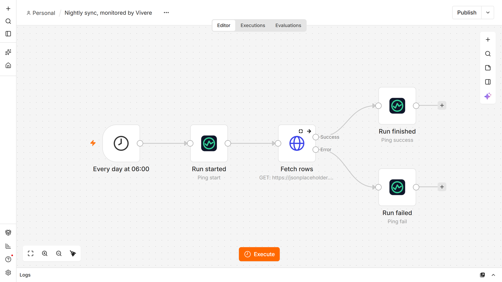
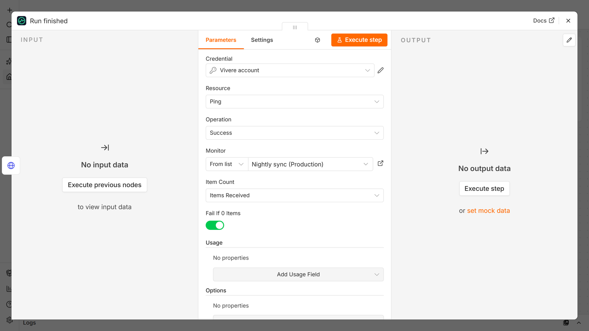

# n8n-nodes-vivere

The [Vivere](https://vivere.dev) node for [n8n](https://n8n.io). It tells you when a workflow stopped running, finished without doing anything, or failed.

n8n's Error Workflow only fires when an execution fails. A Schedule Trigger that never fires (the instance was restarting at that minute, the workflow got deactivated, the timezone is not the one you think) leaves no execution behind, so nothing reports it. Vivere expects a ping on a schedule and alerts you when one does not arrive in time.



**Watch the demo** (5:43): installing the node, creating a monitor, reporting runs from a workflow and from an AI Agent, and how Vivere alerts you.

[](https://www.youtube.com/watch?v=sDGFDhe-Wns)

## Setup

1. **Install the node.** In n8n, open **Settings → Community Nodes → Install** and enter `n8n-nodes-vivere`.
2. **Add your API key.** Create a key at [vivere.dev/app/keys](https://vivere.dev/app/keys), then in n8n add a **Vivere API** credential and paste it in.
3. **Ping at the end of the workflow.** Add a Vivere node after the last step, choose **Ping → Success**, and pick the monitor from the list. Set the monitor's period to the trigger's schedule, so a workflow on _Every hour_ gets `period 1h`. If you have no monitor yet, create one in Vivere or with the node's **Monitor → Create** operation.

That is enough to be alerted when the workflow stops running. The rest of this page is optional.

## Operations

### Ping

Every ping operation sends **one ping per execution**, however many items reach the node, and passes its input items through unchanged, so the node can sit in the middle of a workflow.

- **Start** marks the start of a run, so Vivere records how long it took. Put it right after the trigger.
- **Success** reports a finished run. Options:
  - **Item Count**: how many items the run handled, shown on the run in Vivere. _Items Received_ (the default) counts the items that reached the node, _Custom_ takes a number or an expression, _Don't Report_ sends none. A single empty item, which is what a node with _Always Output Data_ passes on when it found nothing, counts as 0.
  - **Fail If 0 Items**: when the count is 0, report the run as failed instead. A run that finished without handling anything then alerts like a broken one.
  - **Usage**: model, input tokens, output tokens, cache read and cache write tokens, and cost in USD. Map them from an AI node's output with expressions, and Vivere shows what each run cost and can alert when a monitor's cost passes a limit.
  - **Run Log**: text to keep with the run, such as a summary.
- **Fail** reports a failed run, which marks the monitor down at once instead of waiting for the deadline. **Message** is optional. Left empty, the node sends the error it finds in its input: from an Error Trigger that is the error message, the node that failed, the workflow name and a link to the execution; from a node's error output it is the error message.

The monitor can be picked from the list, pasted as its ping URL, or given as its ID.

### Monitor

- **Create** makes a heartbeat monitor with a name, a schedule (a period such as `1h`, or a cron expression with a timezone) and a grace, and returns it, including its `ping_url`. Optional: the page to put it on, tags, a description, and whether it is public.

Grace is how late a ping may be before you hear about it. Allow for the run's longest normal duration plus the delay before n8n starts it; [the grace calculator](https://vivere.dev/tools/grace-period) works it out.

## Example workflow

[examples/nightly-sync.json](examples/nightly-sync.json) is a daily workflow with all three pings. Import it with **Import from File** in the workflow menu, then pick your monitor in the three Vivere nodes.

- **Run started** pings Start after the Schedule Trigger.
- **Fetch rows** has _On Error_ set to _Continue (using error output)_ and _Always Output Data_ on.
- **Run finished** pings Success with _Fail If 0 Items_ on, so a day that fetched nothing alerts.
- **Run failed** sits on the error output and pings Fail with the error message.



## Using it from an Error Trigger

If your workflows already share an Error Workflow, add a Vivere node after its **Error Trigger** with **Ping → Fail** and leave **Message** empty. The run in Vivere then shows the error, the node that failed, the workflow and a link to the execution.

With one monitor per workflow, set **Monitor** to **ID** and pick the ID by workflow name with an expression:

```
{{ ({ 'Nightly sync': '0f6c3a52-8d1e-4b7a-9c2f-5e4d3b2a1c0f', 'Invoice export': '7d2e9b10-4c3a-4f5e-8a6b-1c2d3e4f5a6b' })[$json.workflow.name] }}
```

Keep the Success ping in each workflow as well. The Error Trigger covers runs that fail; only a missing Success ping covers runs that never happen.

## Credentials

The **Vivere API** credential takes an API key from [vivere.dev/app/keys](https://vivere.dev/app/keys) (keys start with `vv_`). n8n checks it by listing your pages. The node uses the key to list monitors and pages and to create monitors. The pings themselves go to the monitor's ping URL and do not carry the key.

## Compatibility

Tested on n8n 2.43.7. The package has no runtime dependencies.

## Resources

- [Vivere's n8n guide](https://vivere.dev/docs/n8n)
- [Why an n8n Schedule Trigger stops firing](https://vivere.dev/answers/n8n-schedule-trigger-not-firing)
- [Vivere API reference](https://vivere.dev/docs/api)
- [n8n community nodes documentation](https://docs.n8n.io/integrations/#community-nodes)

## License

[MIT](LICENSE.md)
